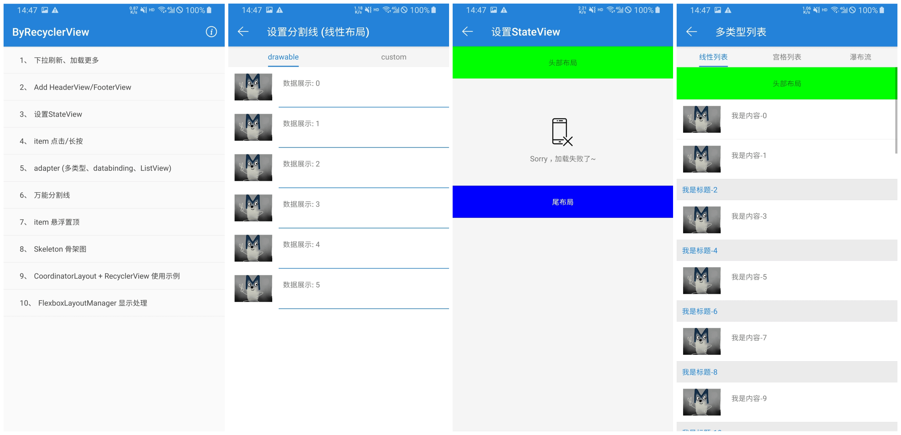

# ByRecyclerView

[English](README_EN.md) | 简体中文

[![jitpack][1]][2] 
[![API][5]][6]
[![Apache License 2.0][3]][4]
[![download][7]][8]
[![Maintained][9]][10]

ByRecyclerView 提供了下拉刷新、上拉松手/自动加载更多、 添加HeaderView/FooterView、setStateView、item点击/长按、item局部刷新、万能分割线、粘性header、极简Adapter(databinding)等功能。

**ByRecyclerView is an Android RecyclerView library** for pull-to-refresh, automatic or pull-up load more, headers and footers, empty states, and a simplified adapter. 它适用于 Android View 系统中的列表页面，不是 Jetpack Compose 原生组件。

### English summary

- Pull-to-refresh (also works with SwipeRefreshLayout) and pull-up or automatic load more with a configurable preload distance.
- Header, footer and state views; `setPageData()` handles first-page empty states and later-page updates.
- Simplified adapters (DataBinding supported), item/child click and long-click listeners, payload partial refresh.
- Item decorations for linear, grid and staggered-grid layouts, sticky headers, skeleton screens.

```groovy
implementation 'com.github.youlookwhat:ByRecyclerView:1.4.2' // requires the JitPack repository
```

See [README_EN.md](README_EN.md) for full installation steps and Java/Kotlin examples.

## 维护状态 / Status

**维护中（Actively maintained）**：最新版本 [1.4.2](https://github.com/youlookwhat/ByRecyclerView/releases/tag/1.4.2)，可通过 JitPack 引用（见上方 JitPack 徽章显示的最新版本）。欢迎在 [Issues](https://github.com/youlookwhat/ByRecyclerView/issues) 反馈问题。

**Actively maintained.** Latest release: 1.4.2, available via JitPack. Please report problems in [Issues](https://github.com/youlookwhat/ByRecyclerView/issues).

## 使用 AI 接入

如果希望 AI 帮你在现有 Android 项目中接入，可以复制下面的提示词，并按实际需求修改。它会引导 AI 阅读 [AI 接入指南 AGENTS.md](AGENTS.md)（该文件不会自动加载到其他项目）：

```text
请使用 https://github.com/youlookwhat/ByRecyclerView 为当前 Android View 项目的列表实现下拉刷新和自动加载更多。请先阅读仓库的 README 和 AGENTS.md，结合本项目的 Gradle 配置、数据接口和现有代码完成接入，处理空状态、加载失败、重试和没有更多数据，并编译及验证；无法验证的部分请说明。
```

按实际项目替换需求，例如上拉松手加载、Kotlin 或 Java；Compose 原生列表不适用。完整的安装和 Java/Kotlin 示例见 [英文快速开始](README_EN.md#quick-start)。

## 功能特性
 - 1.下拉刷新 / 支持SwipeRefreshLayout
 - 2.自定义 下拉刷新布局 / 加载更多布局
 - 3.加载更多机制：**上拉松手 / 自动加载更多**
 - 4.Add HeaderView、FooterView、StateView
 - 5.item及子view的点击/长按事件(防止重复点击)
 - 6.item 局部刷新
 - 7.优化过的BaseAdapter (RV/LV)，减少大量代码
 - 8.Adapter结合DataBinding/ViewBinding使用 (RV/LV)
 - 9.可添加 万能分隔线（线性/宫格/瀑布流）
 - 10.可配置 Skeleton骨架图
 - 11.仿京东首页 RecyclerView嵌套滑动置顶示例
 - 12.可配置自动加载更多机制 和 设置预加载条数

> 最新：setPageData()一行代码处理 列表显示数据和空视图

## Document
 - [项目介绍](https://github.com/youlookwhat/ByRecyclerView/wiki/%E9%A1%B9%E7%9B%AE%E4%BB%8B%E7%BB%8D) | [wiki示例文档](https://github.com/youlookwhat/ByRecyclerView/wiki) | [更新日志 (1.4.2)](https://github.com/youlookwhat/ByRecyclerView/wiki/Update-log)
 - [ByRecyclerView：更方便的使用下拉刷新及加载更多](https://juejin.im/post/5e0980fbe51d4558083345fc)
 - [ByRecyclerView：真·万能分割线 (线性/宫格/瀑布流)](https://juejin.im/post/5e4ff123e51d4527255ca2e1)
 - [RecyclerView嵌套滑动置顶 项目应用篇](https://juejin.cn/post/6941996743974191111)


## Screenshots



### 下载试用
[AndroidX版本(Apk-Demo)](https://github.com/youlookwhat/download/raw/main/ByRecyclerView.apk)

<!--</img>
-->

## 如何使用
> 建议直接看 [示例代码](https://github.com/youlookwhat/ByRecyclerView/blob/master/app/src/main/java/me/jingbin/byrecyclerview/MainActivity.java) 或 [Wiki文档](https://github.com/youlookwhat/ByRecyclerView/wiki)

### 快速开始
以下是使用 `settings.gradle` 管理仓库的项目配置。如果项目仍使用根目录 `build.gradle` 中的 `allprojects.repositories`，请将 JitPack 加到那里，不要重复配置。确保同时保留 Google 和 Maven Central 仓库。

```groovy
// settings.gradle
dependencyResolutionManagement {
    repositories {
        google()
        mavenCentral()
        maven { url 'https://jitpack.io' }
    }
}
```

Kotlin DSL：

```kotlin
// settings.gradle.kts
dependencyResolutionManagement {
    repositories {
        google()
        mavenCentral()
        maven { url = uri("https://jitpack.io") }
    }
}
```

在应用模块添加依赖：

```groovy
dependencies {
    implementation 'com.github.youlookwhat:ByRecyclerView:1.4.2'
    implementation 'androidx.recyclerview:recyclerview:1.3.0'
    implementation 'com.google.android.material:material:1.10.0'
}
```

```kotlin
// build.gradle.kts
dependencies {
    implementation("com.github.youlookwhat:ByRecyclerView:1.4.2")
    implementation("androidx.recyclerview:recyclerview:1.3.0")
    implementation("com.google.android.material:material:1.10.0")
}
```

库模块将 RecyclerView 和 Material 声明为 `compileOnly`，应用需要提供这些依赖；已有依赖时请选用与项目兼容的版本。库模块声明的 `minSdk` 为 14，实际最低版本还取决于应用使用的依赖。

在 XML 布局中引用 ByRecyclerView：

```xml
<me.jingbin.library.ByRecyclerView
    android:id="@+id/recyclerView"
    android:layout_width="match_parent"
    android:layout_height="match_parent"
    tools:layoutManager="LinearLayoutManager"
    tools:listitem="@layout/item_main" />
```

使用 BaseRecyclerAdapter（示例中的 `list` 是可修改的 `List<String>`）：

```java
mRecyclerView.setLayoutManager(new LinearLayoutManager(this));
BaseRecyclerAdapter<String> mAdapter = new BaseRecyclerAdapter<String>(R.layout.item_main, list) {
    @Override
    protected void bindView(BaseByViewHolder<String> holder, String bean, int position) {
        holder.setText(R.id.tv_text, bean);
    }
};
mRecyclerView.setAdapter(mAdapter);

mAdapter.setNewData(list);   // 设置第一页数据
```
设置监听：

```java
// 下拉刷新监听
mRecyclerView.setOnRefreshListener(new ByRecyclerView.OnRefreshListener() {
            @Override
            public void onRefresh() {
                // 刷新完成
                mRecyclerView.setRefreshing(false);
            }
        });
// 加载更多监听
mRecyclerView.setOnLoadMoreListener(new ByRecyclerView.OnLoadMoreListener() {
    @Override
    public void onLoadMore() {
         // 请求下一页后，根据结果选择一种状态：
         // 成功且还有更多：mAdapter.addData(nextPage); mRecyclerView.loadMoreComplete();
         // 没有更多：mRecyclerView.loadMoreEnd();
         // 请求失败：mRecyclerView.loadMoreFail();
    }
});
```

显示数据：

可直接调用 adapter 的 `setPageData(boolean isFirstPage, List<T> data, int emptyLayoutId)`；必须先通过 `setAdapter` 关联 ByRecyclerView。例如：

```java
mAdapter.setPageData(true, firstPage, R.layout.layout_empty);  // 首页，空列表时显示空布局
mAdapter.setPageData(false, nextPage, R.layout.layout_empty); // 后续页，空列表表示没有更多
```

请求失败时不要传空列表来表示错误：刷新失败调用 `setRefreshing(false)`，加载更多失败调用 `loadMoreFail()`，并在应用中展示错误。完整 Java/Kotlin 示例见 [英文快速开始](README_EN.md#quick-start)。`setPageData` 的实现如下：

```java
/**
 * 设置数据 和 处理空视图。
 * 如果想列表上方显示状态视图(StateView)，不能使用这个方法。
 *
 * @param isFirstPage 是否是第一页
 * @param data        需要设置的数据
 * @param emptyView   空视图的View
 */
public void setPageData(boolean isFirstPage, List<T> data, View emptyView) {
    if (mRecyclerView == null) {
        return;
    }
    if (isFirstPage) {
        // 第一页
        if (data != null && data.size() > 0) {
            // 有数据
            mRecyclerView.setStateViewEnabled(false);
            mRecyclerView.setLoadMoreEnabled(true);
            setNewData(data);
        } else {
            // 没数据，设置空布局
            if (emptyView != null) {
                mRecyclerView.setStateView(emptyView);
            }
            mRecyclerView.setLoadMoreEnabled(false);
            setNewData(null);
        }
    } else {
        // 第二页
        if (data != null && data.size() > 0) {
            // 有数据，显示更多数据
            addData(data);
            mRecyclerView.loadMoreComplete();
        } else {
            // 没数据，显示加载到底
            mRecyclerView.loadMoreEnd();
        }
    }
}
```

### 自动加载更多/预加载
为了适配更多的加载场景，我们增加了自动加载更多的机制，也可以设置预加载的条数，即滑动到倒数第`preLoadNumber `条数据时执行加载更多，相比以前只用在设置监听时加上状态`true`即可，使用方式：

```java
void setOnLoadMoreListener(boolean isAutoLoadMore, OnLoadMoreListener listener)
void setOnLoadMoreListener(boolean isAutoLoadMore, int preLoadNumber, OnLoadMoreListener listener)

/**
 * 设置加载更多监听
 *
 * @param isAutoLoadMore 是否自动加载
 * @param preLoadNumber  自动加载时，默认滑动到倒数第[preLoadNumber]条数据加载，默认1
 * @param listener       监听器
 * @param delayMillis    延迟多少毫秒执行加载更多
 */
void setOnLoadMoreListener(boolean isAutoLoadMore, int preLoadNumber, OnLoadMoreListener listener, long delayMillis)
```

- 1. 如果不设置，默认还是使用上拉松手加载更多机制
- 2. `recyclerView.setLoadMoreEnabled(false)` 会关闭加载更多，而不只是关闭自动模式。
- 3. 不满一屏不加载更多`setNotFullScreenNoLoadMore()`，只对上拉松手加载更多有效

### ItemDecoration
万能分割线，可给Linear/Grid/StaggeredGrid设置，并可配置去除不显示分割线的头部和尾部个数

1.给LinearLayout设置分割线

```java
// 选择1：设置drawable
SpacesItemDecoration itemDecoration = new SpacesItemDecoration(this, SpacesItemDecoration.VERTICAL)
        .setNoShowDivider(1, 1)  // 第一个参数：头部不显示分割线的个数，第二个参数：尾部不显示分割线的个数，默认为1
        .setDrawable(R.drawable.shape_line);// 设置drawable文件

// 选择2：设置颜色、高度、间距等
SpacesItemDecoration itemDecoration = new SpacesItemDecoration(this, SpacesItemDecoration.VERTICAL)
        .setNoShowDivider(1, 1)
        // 颜色，分割线间距，左边距(单位dp)，右边距(单位dp)
        .setParam(R.color.colorBlue, 10, 70, 70);

recyclerView.addItemDecoration(itemDecoration);
```

2.给宫格/瀑布流设置分割线

```java
// 10：间距； true：距屏幕周围是否也有间距
GridSpaceItemDecoration itemDecoration = new GridSpaceItemDecoration(10, true)
        .setNoShowSpace(1, 1);// 第一个参数：头部不显示分割线的个数，第二个参数：尾部不显示分割线的个数，默认为1

recyclerView.addItemDecoration(itemDecoration);
```

### add HeaderView/FooterView、setStateView
```java
// 获取view对应databinding，注意：recyclerView.getParent()
LayoutHeaderViewBinding headerBinding = DataBindingUtil.inflate(LayoutInflater.from(this), R.layout.layout_header_view, (ViewGroup) binding.recyclerView.getParent(), false);
recyclerView.addHeaderView(headerBinding.getRoot());

recyclerView.addFooterView(footerView); // 也可传入布局资源 ID
recyclerView.setStateView(stateView);   // 也可传入布局资源 ID

// headerView、footerView、setStateView 支持一键隐藏，设置后需要notify
recyclerView.setHeaderViewEnabled(false);
recyclerView.setFootViewEnabled(false);
recyclerView.setStateViewEnabled(false);

```

### Item 点击/长按监听
```java
// 防重复点击使用 OnItemFilterClickListener
mRecyclerView.setOnItemClickListener(new ByRecyclerView.OnItemClickListener() {
    @Override
    public void onClick(View v, int position) {
        // 通过adapter获取对应position的数据
        DataItemBean itemData = mAdapter.getItemData(position);
    }
});
mRecyclerView.setOnItemLongClickListener(new ByRecyclerView.OnItemLongClickListener() {
    @Override
    public boolean onLongClick(View v, int position) {
        return false;
    }
});

// 添加 子View的点击/长按事件
holder.addOnClickListener(R.id.tv_text);
holder.addOnLongClickListener(R.id.tv_text);

// 防重复点击使用 OnItemChildFilterClickListener
recyclerView.setOnItemChildClickListener(new ByRecyclerView.OnItemChildClickListener() {
    @Override
    public void onItemChildClick(View view, int position) {
    }
});
recyclerView.setOnItemChildLongClickListener(new ByRecyclerView.OnItemChildLongClickListener() {
    @Override
    public void onItemChildLongClick(View view, int position) {
    }
});
```

### Item 局部刷新
```java
//  设置要局部刷新的position及payload
adapter.refreshNotifyItemChanged(position, PayloadAdapter.PAYLOAD_COLLECT);

// adapter里额外再继承 bindViewPayloads 方法
@Override
protected void bindViewPayloads(@NonNull BaseBindingHolder holder, @NonNull DataItemBean bean, @NonNull ItemPayloadBinding binding, int position, @NonNull List<Object> payloads) {
    for (Object p : payloads) {
        int code = (int) p;
        switch (code) {
            case PAYLOAD_ZAN:
                binding.tvZan.setText(bean.getIsZan() == 1 ? "已赞" : "点赞");
                break;
            case PAYLOAD_COLLECT:
                binding.tvCollect.setText(bean.getIsCollect() == 1 ? "已收藏" : "收藏");
                break;
            default:
                break;

        }
    }
}

```

### 设置 Item悬浮置顶
```java
// 1、使用StickyLinearLayoutManager，传入adapter
StickyLinearLayoutManager layoutManager = new StickyLinearLayoutManager(getContext(), mAdapter);

// 2、在adapter里，将悬浮的item的ItemViewType设置为StickyHeaderHandler.TYPE_STICKY_VIEW
@Override
public int getItemViewType(int position) {
    if ("title".equals(getItemData(position).getType())) {
        return StickyHeaderHandler.TYPE_STICKY_VIEW;
    } else {
        return 2;
    }
}
```

### 设置Skeleton骨架图
1.设置item骨架图

```
// 显示
skeletonScreen = BySkeleton
        .bindItem(binding.recyclerView)
        .adapter(mAdapter)// 必须设置adapter，且在此之前不要设置adapter
        .shimmer(false)// 是否有动画
        .load(R.layout.layout_by_default_item_skeleton)// item骨架图
        .angle(30)// 微光角度
        .frozen(false) // 是否不可滑动
        .color(R.color.colorWhite)// 动画的颜色
        .duration(1500)// 微光一次显示时间
        .count(10)// item个数
        .show();

// 隐藏
skeletonScreen.hide();
```
2.设置view骨架图

```java
// 显示
skeletonScreen = BySkeleton
        .bindView(binding.recyclerView)
        .load(R.layout.layout_skeleton_view)// view骨架图
        .shimmer(true)// 是否有动画
        .angle(20)// 微光角度
        .color(R.color.colorWhite)// 动画的颜色
        .duration(1500)// 微光一次显示时间
        .show();

// 隐藏
skeletonScreen.hide();
```

### ViewBinding 使用示例
- 1、由于 DataBinding 和 ViewBinding 最好别同时集成在项目里，所以新建了一个新的项目实践。
- 2、ViewBinding 对封装的不是很友好，demo里给的是没有进行反射处理的示例。
- 3、针对于 ListView 和 RecyclerView 的 adapter 都进行了封装。
- 4、推荐使用 DataBinding。

具体见项目：[ByRv-viewbinding](https://github.com/youlookwhat/android-learning/tree/master/ByRv-viewbinding/app/src/main/java/me/jingbin/byrv/viewbinding)


## 与BRVAH、XRecyclerView对比

<table>
  <tr>
    <th></th>
    <th>ByRecyclerView </th>
    <th> BRVAH </th>
    <th> XRecyclerView </th>
  </tr>
  <tr>
    <td style="text-align:center">下拉刷新布局</td>
    <td>继承基类自定义布局</td>
    <td>无</td>
    <td>只能简单设置样式</td>
  </tr>
  <tr>
    <td style="text-align:center"> SwipeRefreshLayout </td>
    <td>可配合使用</td>
    <td>可配合使用</td>
    <td>不能使用</td>
  </tr>
  <tr>
    <td style="text-align:center">加载更多布局</td>
    <td>继承基类自定义布局</td>
    <td>继承基类设置简单布局</td>
    <td>继承基类自定义类</td>
  </tr>
  <tr>
    <td style="text-align:center">加载更多机制</td>
    <td>上拉松手/自动加载更多</td>
    <td>自动加载更多</td>
    <td>上拉松手加载</td>
  </tr>
  <tr>
    <td style="text-align:center">HeaderView</td>
    <td>多ViewType区别</td>
    <td>同一个item</td>
    <td>多ViewType区别</td>
  </tr>
  <tr>
    <td style="text-align:center">FooterView</td>
    <td>同一个item</td>
    <td>同一个item</td>
    <td>不能添加</td>
  </tr>
  <tr>
    <td style="text-align:center">EmptyView</td>
    <td>可设置</td>
    <td>可设置</td>
    <td>不可设置</td>
  </tr>
  <tr>
    <td style="text-align:center">点击/长按事件</td>
    <td>有</td>
    <td>有</td>
    <td>无</td>
  </tr>
</table>

<!--| |ByRecyclerView| BRVAH | XRecyclerView |
|:--:|:--:|:--:|:--:|
|下拉刷新布局|继承基类自定义布局|无|只能简单设置样式|
|SwipeRefreshLayout|可配合使用|可配合使用|不能使用|
|加载更多布局|继承基类自定义布局|继承基类设置简单布局|继承基类自定义类|
|加载更多机制|不足一屏上拉加载，超过后触底加载|不足一屏即加载|触底加载|
|HeaderView|多ViewType区别|同一个item|多ViewType区别|
|FooterView|同一个item|同一个item|不能添加|
|EmptyView|可设置|可设置|不能设置|
|点击/长按事件|有|有| 无 |-->

ByRecyclerView 是XRecyclerView的拓展，可完全替换XRecyclerView，对于BRVAH它的区别在于：

 - headerView使用的是多type的形式，即一个header就是一个position
 - 可简单设置 上拉松手/自动加载更多 两种加载方式
 - 自带下拉加载布局，也可使用三方刷新框架，比如SwipeRefreshLayout
 - 万能分割线(LinearLayout / GridLayout / StaggeredGridLayout)
 - 可设置Skeleton 骨架图

## 混淆
此资源库没有使用到任何序列化、反序列化、JNI、反射，无需进行额外的混淆操作，并且已经测试通过，在实际项目中使用，如果你在项目混淆之后出现问题，请及时联系我。

## Issues
如果有任何问题，请到GitHub的[issue处](https://github.com/youlookwhat/ByRecyclerView/issues)写上你不明白的地方，也可以通过下面提供的方式联系我，我会及时给予帮助。如果此库帮助到了你，欢迎点个star，非常感谢!

## Thanks
 - [XRecyclerView](https://github.com/XRecyclerView/XRecyclerView)
 - [BaseRecyclerViewAdapterHelper](https://github.com/CymChad/BaseRecyclerViewAdapterHelper)
 - [PersistentRecyclerView](https://github.com/xmuSistone/PersistentRecyclerView)

## About me
 - **QQ**： 770413277
 - **掘金**：[Jinbeen](https://juejin.cn/user/201965867640862/posts)
 - **CSDN**：[Jinbeen](https://blog.csdn.net/jingbin_?type=blog)
 - **Email**： jingbin127@163.com

## License
```
Copyright (C) 2016 Bin Jing

Licensed under the Apache License, Version 2.0 (the "License");
you may not use this file except in compliance with the License.
You may obtain a copy of the License at

http://www.apache.org/licenses/LICENSE-2.0

Unless required by applicable law or agreed to in writing, software
distributed under the License is distributed on an "AS IS" BASIS,
WITHOUT WARRANTIES OR CONDITIONS OF ANY KIND, either express or implied.
See the License for the specific language governing permissions and
limitations under the License.
```

[1]:https://jitpack.io/v/youlookwhat/ByRecyclerView.svg
[2]:https://jitpack.io/#youlookwhat/ByRecyclerView
[3]:https://img.shields.io/:License-Apache%202.0-blue.svg
[4]:https://www.apache.org/licenses/LICENSE-2.0.html
[5]:https://img.shields.io/badge/API-14%2B-red.svg?style=flat
[6]:https://android-arsenal.com/api?level=14
[7]:https://img.shields.io/badge/download-apk-blue.svg?style=flat
[8]:https://github.com/youlookwhat/download/raw/main/ByRecyclerView.apk
[9]:https://img.shields.io/badge/maintained-yes-brightgreen.svg
[10]:https://github.com/youlookwhat/ByRecyclerView/issues
